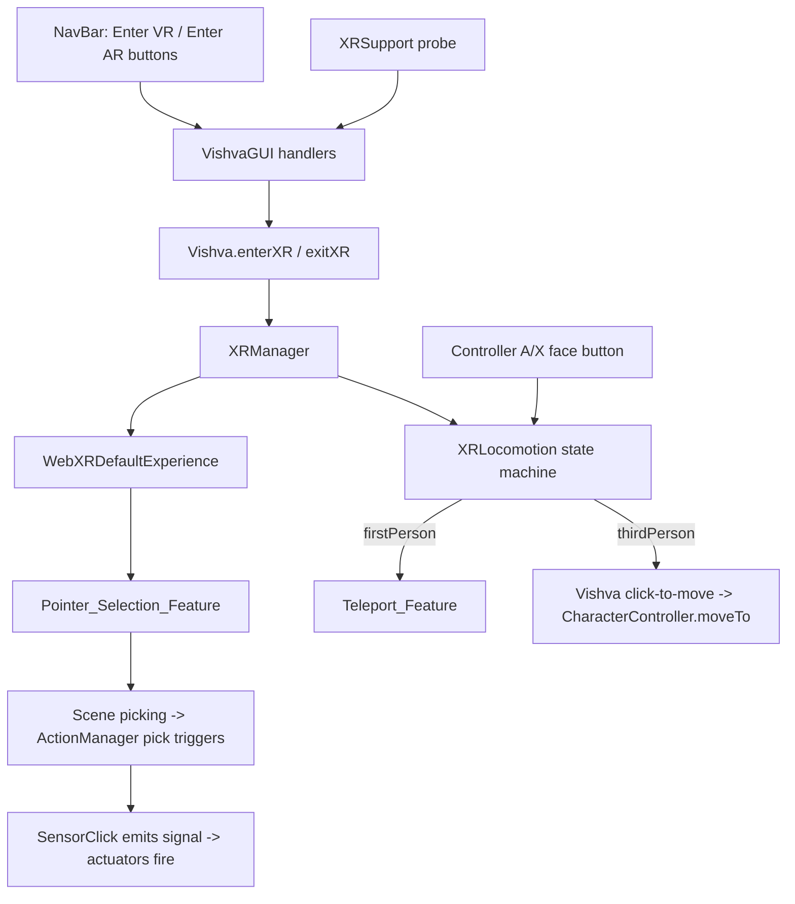

# Design Document: WebXR Support

## Overview

WebXR Support adds an immersive VR/AR preview mode to Vishva without altering desktop editing. The design introduces three cooperating pieces in `src/managers/`:

- **`XRSupport`** — a thin async capability probe plus a pure mapping from capabilities to NavBar button state.
- **`XRLocomotion`** — a pure state machine for the first/third-person sub-mode with the `noFirstPerson` guard.
- **`XRManager`** — the BabylonJS-facing lifecycle owner: creates the default XR experience, wires teleport/pointer features, drives locomotion, routes controller select to picking, and restores desktop state on exit.

`Vishva` gains `enterXR('vr' | 'ar')`, `exitXR()`, and delegates to `XRManager`. `VishvaGUI` adds handlers for two new NavBar buttons, gated by `XRSupport` at startup. XR reuses the existing avatar, `CharacterController`, scene picking, and SNA `ActionManager` pick triggers.

### Design Decisions

- **Pure logic split out**: `XRSupport`'s capability→button mapping and the entire `XRLocomotion` state machine are BabylonJS-free pure logic, so they are unit- and property-testable without a scene or headset. This mirrors the existing `PlacementCalculator` pattern.
- **Single lazily-created XR experience**: `WebXRDefaultExperience` is created once on first use and reused. Repeated enter/exit toggles the session, not the whole experience, avoiding leaks and re-init cost.
- **Feature reconfiguration, not recreation, on mode toggle**: switching locomotion enables/disables the Teleport_Feature and swaps the select handler behavior; the pointer selection feature stays enabled for both modes so SNA interaction always works.
- **Reuse click-to-move**: Third-person locomotion reuses the existing `_clickMove`/`_marker`/`cc.moveTo(...)` mechanism in `Vishva` rather than duplicating movement code. `XRManager` calls into a small `Vishva` entry point that performs the pick→`moveTo` (with marker) already established at `Vishva.ts:1200-1208`.
- **Picking-based SNA**: BabylonJS's WebXR pointer selection dispatches through the scene pointer/picking system, so `ActionManager` pick triggers used by `SensorClick` fire from an XR select with minimal glue. The design verifies this rather than reimplementing SNA dispatch.
- **Render pipeline safety**: SSAO2 + prepass are attached to the editor camera and can destabilize an XR session. `XRManager` disables them on enter and restores on exit, recording prior enabled state.

## Architecture



### Module Boundaries

| Module | Responsibility |
|--------|---------------|
| `XRSupport` | Probe `immersive-vr` / `immersive-ar` support; pure map capabilities → button state. No session lifecycle. |
| `XRLocomotion` | Pure sub-mode state machine with `noFirstPerson` guard. No BabylonJS. |
| `XRManager` | Session lifecycle, feature wiring, locomotion execution, controller input, select→pick routing, desktop restore. |
| `Vishva` | Owns `XRManager`; exposes `enterXR/exitXR`; provides the click-to-move entry point reused by third-person locomotion. |
| `VishvaGUI` / `NavBarML` | Buttons + handlers; startup gating via `XRSupport`. |

## Components and Interfaces

### XRSupport (thin probe + pure mapping)

```typescript
export interface XRSupportState {
    vrSupported: boolean;
    arSupported: boolean;
}

export interface XRButtonState {
    vr: { visible: boolean; enabled: boolean };
    ar: { visible: boolean; enabled: boolean };
}

/** Thin async probe. Never throws; unsupported/erroring modes resolve to false. */
export async function detectXRSupport(): Promise<XRSupportState>;

/** Pure mapping: capabilities -> button visibility/enabled model. */
export function computeXRButtonState(support: XRSupportState): XRButtonState;
```

`detectXRSupport` uses `WebXRSessionManager.IsSessionSupportedAsync("immersive-vr")` and `("immersive-ar")`, each wrapped so rejection/absence yields `false`. If `navigator.xr` is undefined, both are `false` (Requirement 1.2, 1.3).

`computeXRButtonState` (pure, Requirement 1.4): a mode's button is `visible` and `enabled` iff that mode is supported; unsupported → `{ visible: false, enabled: false }`.

### XRLocomotion (pure state machine)

```typescript
export type LocomotionMode = 'firstPerson' | 'thirdPerson';

export interface ToggleResult {
    mode: LocomotionMode;   // resulting mode
    changed: boolean;       // whether mode changed
    blocked: boolean;       // whether a first-person request was denied
}

export class XRLocomotion {
    constructor(initial?: LocomotionMode); // default 'thirdPerson'
    getMode(): LocomotionMode;
    setMode(mode: LocomotionMode, canFirstPerson: boolean): ToggleResult;
    toggle(canFirstPerson: boolean): ToggleResult;
}
```

Semantics (Requirement 4):
- `toggle(canFirstPerson)`: if current is `thirdPerson`, attempt to go `firstPerson`: allowed only when `canFirstPerson` is true (else `blocked:true, changed:false`, stays `thirdPerson`). If current is `firstPerson`, go `thirdPerson` (always allowed, never blocked).
- `setMode('firstPerson', false)` → blocked, stays whatever non-first-person value; `setMode('thirdPerson', _)` → always succeeds.
- Invariant: with `canFirstPerson` always false, mode never becomes `firstPerson`.

### XRManager (BabylonJS lifecycle)

```typescript
export type XRSessionType = 'vr' | 'ar';

export class XRManager {
    constructor(private vishva: Vishva);

    isInXR(): boolean;

    enterVR(): Promise<void>;
    enterAR(): Promise<void>;
    exitXR(): Promise<void>;

    // internal
    private ensureExperience(): Promise<WebXRDefaultExperience>;
    private onSessionStart(type: XRSessionType): void;
    private onSessionEnd(): void;
    private applyLocomotionMode(mode: LocomotionMode): void;
    private handleToggleRequest(): void;      // derives canFirstPerson from CC noFirstPerson
    private handleSelect(pickInfo): void;      // third-person: pick -> moveTo; SNA handled by picking
    private disableDesktopPipeline(): void;    // record + disable SSAO2/prepass
    private restoreDesktopPipeline(): void;    // restore recorded state + activeCamera
}
```

Key behaviors:
- `ensureExperience()` lazily calls `scene.createDefaultXRExperienceAsync({ disableTeleportation: true })` once (teleport is managed manually per locomotion mode) and caches it (Requirement 3.1). Pointer selection stays enabled for SNA.
- `enterVR`/`enterAR` guard on `XRSupport`; if unsupported, they no-op and leave desktop untouched (Requirement 2.6, 3.5). Otherwise they enter the session for the mode via the experience's base session manager.
- Session state is tracked from `WebXRState` changes; `onSessionStart` disables the desktop pipeline, sets the default locomotion mode from `noFirstPerson`, and applies the mode. `onSessionEnd` runs restore (Requirements 3.2, 3.3, 9.*).
- `applyLocomotionMode`: first-person enables Teleport_Feature with floor meshes; third-person disables teleport and arms the select→`moveTo` path (Requirements 5, 6).
- `handleToggleRequest`: bound to the controller **A/X face button** (`a-button` on the right controller, `x-button` on the left), subscribed via each motion controller's button component `onButtonStateChangedObservable` and fired on the rising edge of a press. Deliberately NOT the trigger, so trigger-driven select (point-to-move / SNA click) is never conflated with a toggle. It derives `canFirstPerson = !activeCCSettings.noFirstPerson`, calls `XRLocomotion.toggle`; on `changed` reconfigures features; on `blocked` emits feedback (Requirement 7). Falls back to no toggle binding if the connected controller profile exposes neither `a-button` nor `x-button`.
- `handleSelect`: in third-person, if pick has a valid point, drive `vishva` click-to-move (`moveTo` + marker). SNA click still fires because selection goes through scene picking (Requirements 6, 8).

### Vishva Changes

```typescript
class Vishva {
    public xrManager: XRManager;                 // lazily constructed
    public enterXR(type: XRSessionType): Promise<void>;
    public exitXR(): Promise<void>;

    // reused by third-person XR locomotion (extract existing click-to-move body)
    public moveAvatarTo(target: Vector3): void;  // performs marker + cc.moveTo, mirrors Vishva.ts:1200-1208
}
```

`moveAvatarTo` factors the existing right-click move-to logic so both desktop click-to-move and XR third-person share one implementation.

### VishvaGUI / NavBar Changes

- `NavBarML.ts`: add `#navEnterVR` and `#navEnterAR` buttons (Material Icons) after `navSettings`.
- `VishvaGUI`: on startup call `detectXRSupport()`, apply `computeXRButtonState` to show/hide/disable buttons; wire click handlers to `vishva.enterXR('vr'|'ar')`.

## Data Models

### Session Type

```typescript
type XRSessionType = 'vr' | 'ar';
```

### Recorded Desktop Pipeline State

```typescript
interface DesktopPipelineSnapshot {
    depthRendererEnabled: boolean;
    ssaoAttached: boolean;
    prepassSamples?: number;
    activeCamera: Camera;   // arcCamera reference to restore
}
```

Captured on session start, restored on session end (Requirements 3.3, 9.1, 9.2).

## Correctness Properties

*A property is a characteristic or behavior that should hold true across all valid executions of a system — a formal statement about what the system should do, serving as the bridge between human-readable specifications and machine-verifiable correctness guarantees.*

### Property 1: Capability mapping reflects support exactly

*For any* `XRSupportState`, `computeXRButtonState` SHALL mark a mode's button as visible and enabled if and only if that mode is supported, and SHALL never enable a button for an unsupported mode.

**Validates: Requirements 1.4, 2.2, 2.3, 2.6**

### Property 2: First-person is unreachable without permission

*For any* sequence of `toggle`/`setMode` operations in which every operation supplies `canFirstPerson = false`, the resulting `LocomotionMode` SHALL never be `firstPerson`, and every attempt to reach `firstPerson` SHALL be reported as `blocked` with `changed = false`.

**Validates: Requirements 4.3, 4.6**

### Property 3: Toggle involution under permission

*For any* starting `LocomotionMode`, applying `toggle(true)` twice SHALL return the mode to its starting value, and each permitted transition SHALL be reported with `changed = true` and `blocked = false`.

**Validates: Requirements 4.4, 4.5**

### Property 4: Third-person move requires a valid pick

*For any* XR_Select event, `CharacterController.moveTo` SHALL be invoked with the picked point when the pick has a hit point, and SHALL NOT be invoked when the pick has no hit point.

**Validates: Requirements 6.1, 6.3**

### Property 5: Toggle capability derives from noFirstPerson

*For any* value of the active Character_Controller's `noFirstPerson`, a toggle request SHALL pass `canFirstPerson` equal to the negation of `noFirstPerson`, so that a blocked toggle occurs exactly when `noFirstPerson` is true and the requested mode is `firstPerson`.

**Validates: Requirements 7.2, 7.4**

## Error Handling

| Scenario | Handling |
|----------|----------|
| `navigator.xr` undefined | `detectXRSupport` resolves `{vr:false, ar:false}`; no buttons enabled. |
| `IsSessionSupportedAsync` throws/rejects | That mode treated as unsupported (false). |
| Enter requested for unsupported mode | `enterVR/enterAR` no-op; desktop untouched. |
| `exitXR` with no active session | Idempotent no-op. |
| Session ends unexpectedly (headset removed) | `WebXRState` change triggers `onSessionEnd` → desktop restore. |
| Third-person select with no pick hit | No `moveTo`; SNA also has nothing to trigger. |
| Toggle to first-person while `noFirstPerson` | Stays third-person; feedback (log/haptic). |
| Ground/floor mesh absent for teleport | Teleport registered with available walkable meshes; no crash if none. |
| Re-enter after exit | Cached experience reused; features re-applied for the fresh session. |

## Testing Strategy

### Property-Based Tests (fast-check + Vitest)

**Library**: fast-check 4.7.0 · **Runner**: Vitest 4.1.5 · **Min iterations**: 100 per property.

- `src/managers/XRLocomotion.property.test.ts`
  - Property 2: first-person unreachable without permission (random toggle/setMode sequences with `canFirstPerson=false`).
  - Property 3: toggle involution under permission.
- `src/managers/XRSupport.property.test.ts` (optional)
  - Property 1: capability mapping over all four `{vr,ar}` boolean combinations and random sequences.

Each property test tags: `Feature: webxr-support, Property N: <description>`.

### Unit Tests (Vitest)

- `src/managers/XRSupport.test.ts` — `computeXRButtonState` for all combinations (both, VR-only, AR-only, none); `detectXRSupport` with mocked/absent `navigator.xr` resolves without throwing.
- `src/managers/XRLocomotion.test.ts` — explicit toggle/setMode cases incl. blocked transitions and default mode.
- `src/managers/XRManager.test.ts` — with a mocked XR experience/feature manager: enter/exit state tracking, pipeline disable→restore ordering, `applyLocomotionMode` enabling teleport only in first-person, `handleToggleRequest` deriving `canFirstPerson` from `noFirstPerson`, `handleSelect` calling `moveTo` only on valid pick, idempotent `exitXR`, and enter→exit→enter restoring expected state.
- `src/gui/NavBarML.test.ts` (extend) — asserts `#navEnterVR` and `#navEnterAR` exist with correct titles; GUI gating logic maps button state to visibility/enabled.

### Integration / Manual (device or WebXR emulator)

Requires HTTPS or localhost and a compatible device/emulator:
- Enter VR/AR from NavBar; scene renders in-headset; exit returns to desktop editor intact.
- First-person teleport onto ground; third-person point-and-move walks the avatar with animation.
- Controller toggle switches modes; `noFirstPerson` avatar stays third-person.
- Selecting a SensorClick object fires its actuator in XR.
- Repeated enter/exit leaves no console errors and preserves SSAO/editing.

## Notes

- BabylonJS 8.56.2 WebXR APIs: `scene.createDefaultXRExperienceAsync`, `WebXRDefaultExperience`, `WebXRState`, `WebXRSessionManager.IsSessionSupportedAsync`, `WebXRFeaturesManager` (teleportation, pointer selection).
- The pure modules (`XRSupport` mapping, `XRLocomotion`) carry the machine-verifiable properties; `XRManager` is validated with mocks; headset behavior is validated manually.
- Third-person locomotion intentionally shares `Vishva.moveAvatarTo` with the existing desktop click-to-move to avoid divergence.
