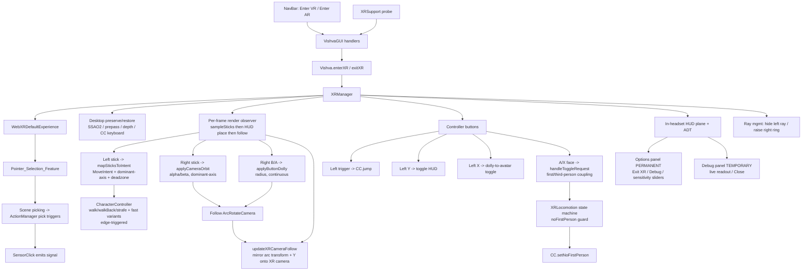

# Design Document: WebXR Support

## Overview

WebXR Support adds an immersive VR/AR preview mode to Vishva without altering desktop editing. Movement inside a session is driven by the **thumbsticks** through the existing `CharacterController`, and the headset view is a per-frame mirror of the desktop follow `ArcRotateCamera`, so the third-person follow experience carries into XR. The design introduces three cooperating pieces in `src/managers/`:

- **`XRSupport`** — a thin async capability probe plus a pure mapping from capabilities to NavBar button state.
- **`XRLocomotion`** — a pure module with (a) the first/third-person sub-mode state machine (with the `noFirstPerson` guard) and (b) the pure `mapSticksToIntent` that turns left-stick axes into a `MoveIntent`.
- **`XRManager`** — the BabylonJS-facing lifecycle owner: creates the default XR experience, samples the sticks each frame and edge-triggers the CharacterController, orbits/dollies and follows the camera, binds controller buttons, manages controller rays, hosts the in-headset HUD, persists sensitivity settings, and restores desktop state on exit.

`Vishva` gains `enterXR('vr' | 'ar')`, `exitXR()`, and delegates to `XRManager`. `VishvaGUI` adds handlers for two new NavBar buttons, gated by `XRSupport` at startup. XR reuses the existing avatar, `CharacterController`, follow camera, scene picking, and SNA `ActionManager` pick triggers.

> This document was reconciled against the code as built. The implementation diverged substantially from the original teleport/point-to-move-centric plan: **thumbstick locomotion is now primary**, the camera is orbited/dollied and follows the avatar, and an in-headset HUD hosts the exit control and sensitivity settings. Teleportation and point-to-move remain in the codebase but are not the active movement path.

### Design Decisions

- **Pure logic split out**: `XRSupport`'s capability→button mapping, the `XRLocomotion` state machine, and the `mapSticksToIntent` axis mapper are BabylonJS-free pure logic, so they are unit- and property-testable without a scene or headset. This mirrors the existing `PlacementCalculator` pattern.
- **Thumbstick locomotion replaces teleport**: the left stick drives `CharacterController.walk/walkBack/strafeLeft/strafeRight` (and their fast variants), sampled per frame and edge-triggered. Teleport is never enabled by the active flow; the `disableTeleportation` path is kept only to defensively tear down any legacy-enabled feature.
- **Dominant-axis gating**: real thumbsticks bleed onto the off-axis. `mapSticksToIntent` (left stick) and `applyCameraOrbit` (right stick) each activate only the single axis with the larger raw magnitude per frame, so backing up never drifts sideways and orbiting never changes alpha and beta together (the latter is nausea-inducing). Ties resolve to Y on the left stick (forward/back wins) and to X (alpha) on the right stick.
- **Mode selects camera coupling, not movement**: with stick locomotion the first/third-person `LocomotionMode` only decides whether the CharacterController pulls the camera in to the avatar (`setNoFirstPerson(false)`) or holds a third-person offset (`setNoFirstPerson(true)`). The state machine and its `noFirstPerson` guard are unchanged.
- **Follow camera mirrored onto the XR camera**: rather than reimplement the CharacterController's follow math, `updateXRCameraFollow` copies the `ArcRotateCamera` transform onto the rendered `WebXRCamera` each frame via `setTransformationFromNonVRCamera(arcCamera, true)`, then re-applies the arc camera's Y (because the copy forces `position.y = 0`).
- **Right stick controls the camera, not the avatar**: the right stick orbits (`alpha`/`beta`) and the right B/A buttons dolly (`radius`) the follow camera; the avatar is never rotated by the camera controls.
- **Permanent in-headset HUD (Options) + temporary Debug scaffolding**: the HUD plane hosts two modes. The **Options** panel (Exit XR + Debug buttons + three sensitivity sliders) is a permanent, world-locked feature. The **Debug** panel (live pose/controller readout + Close), the `diag*` fields, and the controller/handedness dump are temporary scaffolding added to diagnose an on-device stick bug where console logs are invisible in the headset; they are slated for removal.
- **Sensitivity persistence**: the three orbit/dolly rates are instance fields adjustable via the Options sliders and persisted to `localStorage`, restored each session.
- **Elasticity disabled while the HUD is shown**: the pickable HUD plane obstructs the CharacterController's camera-obstruction ray, causing a jerk; elasticity/springback are disabled while the HUD is visible and restored when hidden or on exit.
- **Controller ray management**: the left ray is hidden (left trigger is jump), and the right ring/laser are raised above the HUD plane's rendering group so pointing stays visible over the panel.
- **Picking-based SNA**: BabylonJS WebXR pointer selection dispatches through the scene picking system, so `ActionManager` pick triggers used by `SensorClick` fire from an XR select; pointer selection is left enabled in both modes.
- **Render pipeline safety**: SSAO2 + prepass + depth renderer are disabled on enter (state recorded) and restored on exit.

## Architecture



### Module Boundaries

| Module | Responsibility |
|--------|---------------|
| `XRSupport` | Probe `immersive-vr` / `immersive-ar` support; pure map capabilities → button state. No session lifecycle. |
| `XRLocomotion` | Pure sub-mode state machine with `noFirstPerson` guard **and** the pure `mapSticksToIntent` (left-stick axes → `MoveIntent`, dominant-axis + deadzone). No BabylonJS. |
| `XRManager` | Session lifecycle, pipeline/controller preserve+restore, per-frame stick sampling + edge-triggered CC movement/fast, camera orbit/dolly/follow, controller button binding, controller-ray management, in-headset HUD, sensitivity persistence. |
| `Vishva` | Owns `XRManager`; exposes `enterXR/exitXR`; provides `moveAvatarTo` (marker + `cc.moveTo`) reused by the retained point-to-move helper. |
| `VishvaGUI` / `NavBarML` | Enter VR / Enter AR buttons + handlers; startup gating via `XRSupport`. |

## Components and Interfaces

### XRSupport (thin probe + pure mapping)

```typescript
export interface XRSupportState { vrSupported: boolean; arSupported: boolean; }
export interface XRButtonState {
    vr: { visible: boolean; enabled: boolean };
    ar: { visible: boolean; enabled: boolean };
}

/** Thin async probe. Never throws; unsupported/erroring modes resolve to false. */
export async function detectXRSupport(): Promise<XRSupportState>;

/** Pure mapping: a mode's button is visible AND enabled iff that mode is supported. */
export function computeXRButtonState(support: XRSupportState): XRButtonState;
```

`detectXRSupport` uses `WebXRSessionManager.IsSessionSupportedAsync("immersive-vr" | "immersive-ar")`, each wrapped so rejection/absence yields `false`; absent `navigator.xr` short-circuits both to `false` (Requirements 1.2, 1.3). `computeXRButtonState` is pure (Requirement 1.4).

### XRLocomotion (pure state machine + pure stick mapper)

```typescript
export type LocomotionMode = 'firstPerson' | 'thirdPerson';
export const DEFAULT_STICK_DEADZONE = 0.15;

export interface StickInput { leftX: number; leftY: number; }              // LEFT stick only
export interface MoveIntent {
    walk: boolean; walkBack: boolean; strafeLeft: boolean; strafeRight: boolean;
}
export function neutralMoveIntent(): MoveIntent;

/**
 * Pure LEFT-stick mapping. Dominant-axis: only one of {forward/back} vs {strafe}
 * is active per call (larger raw magnitude wins; ties -> Y). Deadzone gates the
 * winner. Sign: leftY < -dz => walk (forward), leftY > dz => walkBack;
 * leftX > dz => strafeRight, leftX < -dz => strafeLeft. The RIGHT stick is NOT
 * part of this mapper — it drives the camera directly in XRManager.
 */
export function mapSticksToIntent(input: StickInput, deadzone?: number): MoveIntent;

export interface ToggleResult { mode: LocomotionMode; changed: boolean; blocked: boolean; }

export class XRLocomotion {
    constructor(initial?: LocomotionMode);          // default 'thirdPerson'
    getMode(): LocomotionMode;
    setMode(mode: LocomotionMode, canFirstPerson: boolean): ToggleResult;
    toggle(canFirstPerson: boolean): ToggleResult;
}
```

State machine semantics (Requirement 4): a transition to `firstPerson` requires `canFirstPerson === true` (else `blocked:true, changed:false`, mode unchanged); a transition to `thirdPerson` is always allowed and never blocked; `toggle` flips between the two using that rule. Invariant: with `canFirstPerson` always false, mode never becomes `firstPerson`.

### XRManager (BabylonJS lifecycle)

`XRManager` is large; its method surface is grouped by concern below. All BabylonJS/GUI/private-map access is defensively guarded so the manager never throws under the mocked test environment.

**Lifecycle & entry**
- `isInXR()` — true only while a session is active (Requirement 3.4).
- `enterVR()` / `enterAR()` → `enter(type)` — guard on `XRSupport`; unsupported requests no-op leaving desktop untouched (Requirements 2.6, 3.5). Enter the session via the base experience with `local-floor` reference space (Requirement 3.8).
- `exitXR()` — idempotent; no-op when not in session (Requirement 3.7); else calls `exitXRAsync`, and desktop restore runs from the state handler.
- `ensureExperience()` — lazily `createDefaultXRExperienceAsync({ disableTeleportation: true })` once, wires the `WebXRState` observer and the persistent `bindControllerToggle` (Requirement 3.1); pointer selection left enabled.
- `onSessionStart(type)` — load persisted sensitivity, disable desktop pipeline + quiesce CC keyboard, reset per-session state, set + apply default locomotion mode, start the stick sampler, build the (hidden) HUD.
- `onSessionEnd()` — guard on `inXR`; stop movement; detach all per-session observers; clear captures; restore elasticity, pipeline, and controller (Requirements 3.3, 3.6, 19.*).

**Locomotion / sticks**
- `canFirstPerson()` — `!cc.getSettings().noFirstPerson` (Requirement 16.2).
- `applyLocomotionMode(mode)` — ensure teleport disabled; set CC camera coupling `setNoFirstPerson(mode !== 'firstPerson')` (Requirement 5).
- `disableTeleportation(fm)` — defensive teardown of any legacy teleport.
- `startStickSampler()` / `stopStickSampler()` — register/detach the per-frame `onBeforeRenderObservable` observer (Requirement 11.4).
- `sampleSticks()` — read left/right axes; `mapSticksToIntent` → `applyIntent`; `applyCameraOrbit`; `applyButtonDolly`; refresh debug HUD when shown+enabled.
- `applyIntent(cc, intent, fast)` — diff against `lastIntent`/`lastFast`; edge-trigger via `applyMovementDirection` (Requirement 6.6).
- `applyMovementDirection(normal, fast, wasActive, wasFast, isActive, isFast)` — emit minimal on/off calls so a direction runs its normal or fast variant, never both (Requirement 7).
- `stopAllMovement()` — push a neutral intent on exit (Requirement 6.7).
- `bindMotionControllerSticks(mc)` — classify by handedness → `leftStick` (move) / `rightStick` (orbit).

**Camera orbit / dolly / follow**
- `applyCameraOrbit(rightX, rightY)` — dominant-axis (ties→alpha), deadzone-gated, analog; `alpha += alphaRate*x` OR `beta += betaRate*y` then `clampBeta()`; recompute world matrix; never turns the avatar (Requirement 9).
- `applyButtonDolly()` — B held → `radius -= radiusRate`, A held → `radius += radiusRate`; clamp to radius limits; recompute matrix on change (Requirement 10.1–10.3).
- `clampBeta()` — clamp `beta` to the camera's beta limits or a pole-avoiding fallback.
- `toggleXDolly()` — left-X dolly-to-avatar toggle: snap to `lowerRadiusLimit` remembering prior radius, or restore (Requirement 10.4).
- `getXRCamera()` — the rendered `WebXRCamera`.
- `updateXRCameraFollow()` — `setTransformationFromNonVRCamera(arcCamera, true)` then copy arc Y onto XR camera Y (Requirement 11.1, 11.2).

**Controller binding & rays**
- `bindControllerToggle(experience)` — persistent `onControllerAddedObservable` hook; per source track a motion-controller-init observer and call `rememberLeftControllerAndHideRay`.
- `bindMotionController(mc)` — capture diag; `bindMotionControllerSticks`; `bindLeftControllerButtons`; `bindRightControllerHeightButtons`; bind left `x-button` → `toggleXDolly`.
- `bindLeftControllerButtons(mc)` — LEFT only: trigger rising edge → `cc.jump()` (Requirement 8); `y-button` rising edge → `toggleDiagHud` (Requirement 13.3, 13.6).
- `bindRightControllerHeightButtons(mc)` — RIGHT only: capture `b-button` → `radiusDownButton`, `a-button` → `radiusUpButton` (Requirement 10.5).
- `handleToggleRequest()` — derive `canFirstPerson`, drive `XRLocomotion.toggle`, reconfigure coupling on change, emit feedback on block (Requirement 16).
- `emitToggleBlockedFeedback()` — log + best-effort haptic pulse (Requirement 16.4).
- `rememberLeftControllerAndHideRay` / `retryHideLeftControllerRay` / `hideLeftControllerRay` — hide the left ray + selection ring via the pointer-selection feature's private `_controllers` map, retried per frame (Requirement 15.1, 15.3).
- `retryRaiseRightSelectionRing` / `raiseRightSelectionRingRenderingGroup` — raise pointer-selection meshes to `renderingGroupId = 2` above the HUD, retried per frame (Requirement 15.2, 15.3).
- `detach*Observers` — tear down toggle/init/trigger/menu observers on exit (Requirement 19.4).

**HUD** (Options permanent; Debug temporary)
- `createDiagHud()` — build the world-space plane + ADT: semi-transparent panel, Exit XR button, Debug button, Close button, and the three sensitivity slider/label pairs; plane pickable, `renderingGroupId = 1`, starts hidden.
- `toggleDiagHud()` — show/hide with the elasticity-safe ordering (Requirement 13.3, 14.3); on show returns to Options mode and world-locks the panel.
- `applyHudMode()` — flip control visibility + placement model between Options and Debug (Requirement 13.4, 13.5).
- `positionPlaneInFront` / `placeOptionsPanelInFront` / `updateDiagHudPlacement` — one-time world-lock for Options, per-frame head-lock for Debug.
- `updateDiagHud` / `disposeDiagHud` — refresh/tear down (Debug scaffolding).
- `disableCameraElasticityForHud` / `restoreCameraElasticityAfterHud` — Requirement 14.
- `setSensitivitySlidersVisible` / `syncSensitivitySlidersFromFields` — Options slider sync.

**Desktop preserve / restore**
- `disableDesktopPipeline` / `restoreDesktopPipeline` — record + disable/restore depth renderer, SSAO2 (detach/attach `ssaopipeline`), prepass samples; restore `activeCamera` + `attachControl` (Requirements 3.2, 3.3, 19.1, 19.2).
- `disableDesktopController` / `restoreDesktopController` — keep the CC running, disable/restore keyboard; record `ccStarted`/`ccKeyboardEnabled` (Requirement 19.3).
- `getSSAOPipeline` — look up `ssaopipeline` by name.

**Sensitivity persistence**
- `loadSensitivityFromStorage()` — read `vishva.xr.alphaRate|betaRate|radiusRate`; apply only finite, in-range values; guarded (Requirement 12.4, 12.5).
- `saveSensitivityToStorage()` — write all three keys; guarded (Requirement 12.3).

**Retained helper**
- `handleSelect(pickedPoint)` — retained point-to-move: in third-person with a valid pick, start the CC and `vishva.moveAvatarTo`; no valid pick → no move. Not routed by the active flow (Requirement 18).

### Vishva Changes

```typescript
class Vishva {
    public xrManager: XRManager;                 // lazily constructed
    public enterXR(type: XRSessionType): Promise<void>;
    public exitXR(): Promise<void>;
    public moveAvatarTo(target: Vector3): void;  // marker + cc.moveTo — shared with desktop click-to-move
}
```

### VishvaGUI / NavBar Changes

- `NavBarML.ts`: `#navEnterVR` and `#navEnterAR` buttons.
- `VishvaGUI`: on startup call `detectXRSupport()`, apply `computeXRButtonState` to show/hide/disable the buttons; wire click handlers to `vishva.enterXR('vr'|'ar')`.

## Data Models

### Session type

```typescript
type XRSessionType = 'vr' | 'ar';
```

### Stick input & move intent (pure)

```typescript
interface StickInput { leftX: number; leftY: number; }              // raw left-stick axes ~[-1,1]
interface MoveIntent {
    walk: boolean; walkBack: boolean; strafeLeft: boolean; strafeRight: boolean;
}
```

`fast` (run) is not part of `MoveIntent`; it is decided in `XRManager` from `leftStick.pressed` and combined with the intent in `applyIntent`/`applyMovementDirection`.

### Sensitivity rates & constants

```typescript
alphaRate  = DEFAULT_ALPHA_RATE  (0.0075)   // radians/frame at full deflection, clamp 0..MAX_ORBIT_RATE (0.02)
betaRate   = DEFAULT_BETA_RATE   (0.003)    // radians/frame at full deflection, clamp 0..MAX_ORBIT_RATE
radiusRate = DEFAULT_RADIUS_RATE (0.05)     // radius units/frame while B/A held, clamp 0..MAX_RADIUS_RATE (0.2)
stickDeadzone = DEFAULT_STICK_DEADZONE (0.15)
// localStorage keys: vishva.xr.alphaRate / vishva.xr.betaRate / vishva.xr.radiusRate
```

### Recorded desktop snapshots

```typescript
interface DesktopPipelineSnapshot {
    depthRendererEnabled: boolean;
    ssaoAttached: boolean;
    prepassSamples?: number;
    activeCamera: Camera;          // arcCamera reference to restore
}
interface DesktopControllerSnapshot {
    ccStarted: boolean;
    ccKeyboardEnabled: boolean;
}
// HUD-only: { elastic: boolean; springback: boolean } captured while the HUD is shown.
```

## Correctness Properties

*A property is a characteristic or behavior that should hold true across all valid executions of a system — a formal statement about what the system should do, serving as the bridge between human-readable specifications and machine-verifiable correctness guarantees.*

The pure modules carry the machine-verifiable properties: `XRSupport`'s capability mapping, the `XRLocomotion` state machine (including the `noFirstPerson` guard that also backs the in-session toggle), the pure `mapSticksToIntent` left-stick mapper, and the retained `handleSelect` pick guard. Stateful camera and lifecycle behavior (orbit/dolly/follow, HUD, elasticity, ray management, desktop restore, jump, fast) is deterministic against mocks and validated with example/integration tests, not universal properties.

### Property 1: Capability mapping reflects support exactly

*For any* `XRSupportState`, `computeXRButtonState` SHALL mark a mode's button visible and enabled if and only if that mode is supported, and SHALL never enable a button for an unsupported mode.

**Validates: Requirements 1.4, 2.2, 2.3, 2.6**

### Property 2: First-person is unreachable without permission

*For any* sequence of `toggle`/`setMode` operations in which every operation supplies `canFirstPerson = false`, the resulting `LocomotionMode` SHALL never be `firstPerson`, and every attempt to reach `firstPerson` SHALL be reported as `blocked` with `changed = false`.

**Validates: Requirements 4.3, 4.6, 16.2**

### Property 3: Toggle involution under permission

*For any* starting `LocomotionMode`, applying `toggle(true)` twice SHALL return the mode to its starting value, and each permitted transition SHALL be reported with `changed = true` and `blocked = false`; a `thirdPerson` transition SHALL never be blocked.

**Validates: Requirements 4.4, 4.5**

### Property 4: Left-stick mapping is dominant-axis and deadzoned

*For any* `StickInput`, `mapSticksToIntent` SHALL never activate both a forward/back flag and a strafe flag together, SHALL never activate both opposing flags of a single axis, SHALL select the axis of larger raw magnitude (resolving ties to forward/back), and SHALL produce a neutral intent whenever the winning axis is within the deadzone.

**Validates: Requirements 6.2, 6.3, 6.4, 6.5**

### Property 5: Retained third-person move requires a valid pick

*For any* pick input to `handleSelect` in third-person, `CharacterController.moveTo` SHALL be invoked (via `moveAvatarTo`) with the picked point when the pick has a hit point, and SHALL NOT be invoked when the pick has no hit point.

**Validates: Requirements 18.1, 18.2**

## Error Handling

| Scenario | Handling |
|----------|----------|
| `navigator.xr` undefined | `detectXRSupport` resolves `{vr:false, ar:false}`; no buttons enabled. |
| `IsSessionSupportedAsync` throws/rejects | That mode treated as unsupported (false). |
| Enter requested for unsupported mode | `enter` no-op; desktop untouched. |
| `exitXR` with no active session | Idempotent no-op. |
| Session ends unexpectedly (headset removed) | `WebXRState` change triggers `onSessionEnd` → stop movement + desktop restore + observer teardown. |
| No CharacterController (avatar-less world) | `sampleSticks` / `disableDesktopController` no-op. |
| Missing arc camera / non-numeric alpha/beta/radius | `applyCameraOrbit` / `applyButtonDolly` / `toggleXDolly` guarded no-op. |
| `localStorage` absent or throws | `load`/`saveSensitivityToStorage` keep current values, no throw. |
| GUI construction fails (mocked/node env) | `createDiagHud` try/catch leaves HUD absent; all slider/button refs null, visibility flips guarded. |
| Pointer-selection meshes not yet created | Ray-hide / ring-raise retried each frame until present. |
| Beta approaches poles | `clampBeta` clamps within limits or pole-avoiding fallback. |

## Testing Strategy

### Test infrastructure

- **`vitest.setup.ts`** defines a `self` shim (`globalThis.self = globalThis`) so modules that reference the browser `self` at load time (e.g. `babylonjs-editcontrol`, pulled in transitively) do not throw in the node environment. Wired via `setupFiles` in `vitest.config.ts` (`include: src/**/*.test.ts`, `environment: node`).
- **`scripts/gen-cert.js`** generates a self-signed HTTPS cert (via `selfsigned`) into `certs/`, and the `https-server` / `dev:https` package scripts serve over HTTPS so WebXR can be exercised on-device (WebXR requires a secure context).

### Property-based tests (fast-check + Vitest)

**Library**: fast-check 4.7.0 · **Runner**: Vitest 4.1.5 · **Min iterations**: 100 per property. Each tags `Feature: webxr-support, Property N: <description>`.

- `src/managers/XRSupport.property.test.ts` — Property 1 across all `{vr,ar}` combinations.
- `src/managers/XRLocomotion.property.test.ts` — Property 2 (guard invariant), Property 3 (involution), and Property 4 (`mapSticksToIntent` dominant-axis + deadzone).
- `src/managers/XRManager.test.ts` — Property 5 (`handleSelect` pick guard) as fast-check properties over random pick points and interleaved hit/miss sequences.

### Unit / example tests (Vitest, mocked BabylonJS)

`XRManager.test.ts` mocks the BabylonJS XR experience/feature manager and a `CharacterController`, and drives frames via a fake `onBeforeRenderObservable`:
- Lifecycle: `isInXR` tracking, unsupported-mode no-op, idempotent exit, enter→exit→enter reuse, SSAO detach-then-attach ordering, depth/prepass restore, editor-camera reactivation.
- Locomotion: teleport never enabled; default mode from `noFirstPerson`; CC kept running with keyboard disabled; pointer selection never toggled.
- Stick movement: forward/back/strafe edge-triggering, deadzone, stop-on-exit, sampler detach.
- Fast movement: `leftStick.pressed` switches normal↔fast for the active direction.
- Camera orbit: alpha/beta changes, dominant-axis (ties→alpha), beta clamp, no avatar turn.
- Camera dolly: continuous B/A radius delta + clamp, right-only capture, left-X dolly toggle round-trip, cleared on exit.
- Follow: per-frame `setTransformationFromNonVRCamera` + arc-Y copy.
- Jump: left trigger → one `cc.jump()`, right trigger → none, observers detached on exit.
- HUD/elasticity: y-button toggles visibility, options placement deferred, elasticity disabled while shown.
- Ray management: left ray hidden, right ring raised to group 2, flags latch.
- Toggle binding: A/X face-button binding, trigger never bound, feedback on block.
- Sensitivity: default when storage absent, load applies in-range values, save writes three keys.
- Cleanup: observer add-count === remove-count across cycles.

Extend `src/gui/NavBarML.test.ts` for `#navEnterVR`/`#navEnterAR` presence and gating.

### Integration / manual (device or WebXR emulator)

Requires HTTPS/localhost and a compatible device/emulator: enter VR/AR from the NavBar; stick move + fast + jump; right-stick orbit and B/A dolly; follow camera tracks the avatar; HUD toggle, Options sliders persist, Debug readout; left ray hidden and right ring visible over the HUD; selecting a `SensorClick` object fires its actuator in XR; repeated enter/exit leaves no errors and preserves SSAO/editing.

## Known Issues / Deferred

- **Entry drop**: on XR entry the scene briefly renders at head height, then drops as `updateXRCameraFollow`'s first follow frame snaps the XR camera Y down to the follow camera's low Y. Mitigated by keeping the HUD hidden until the Y-press (so its world-lock reads a settled pose); root-cause fix deferred.
- **Move + jump exclusivity**: `CharacterController.jump()` resets the movement action state, so simultaneous move-and-jump does not work. Deferred to a future CharacterController enhancement.
- **Debug HUD scaffolding removal**: the Debug panel, the `diag*` fields, the `captureDiagController` handedness/component dump, and the `babylonjs-gui` diagnostic text are temporary and slated for removal once the on-device stick/handedness bug is resolved. The Options panel (Exit XR, Debug button, sensitivity sliders) and the sensitivity persistence are permanent and stay.

## Notes

- BabylonJS 8.56.2 WebXR APIs: `scene.createDefaultXRExperienceAsync`, `WebXRDefaultExperience`, `WebXRState`, `WebXRSessionManager.IsSessionSupportedAsync`, `WebXRCamera.setTransformationFromNonVRCamera`, `WebXRFeaturesManager` (teleportation, pointer selection), and `babylonjs-gui` for the HUD.
- The pure modules (`XRSupport` mapping, `XRLocomotion` state machine + `mapSticksToIntent`) carry the machine-verifiable properties; `XRManager` is validated with mocks; headset behavior is validated manually over HTTPS.
