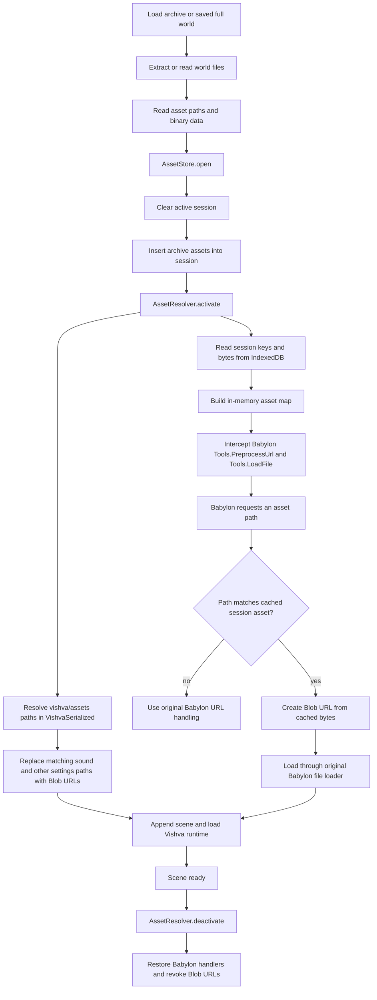
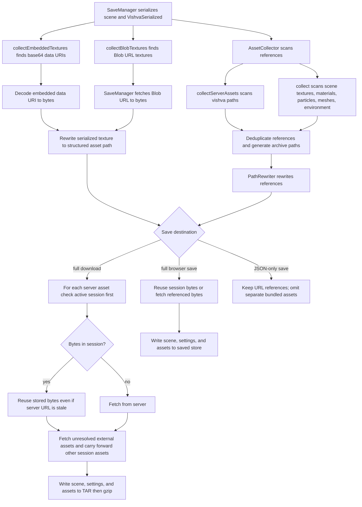
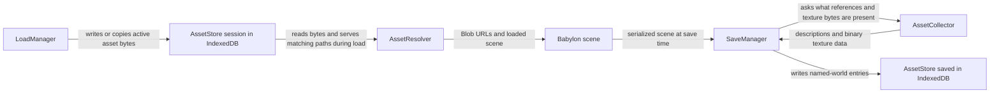

# Asset storage, resolution, and collection

This document explains the roles of [`AssetStore`](../src/managers/AssetStore.ts),
[`AssetResolver`](../src/managers/AssetResolver.ts), and
[`AssetCollector`](../src/managers/AssetCollector.ts), and how the load and save
managers connect them.

## The three components

| Component | Responsibility | Does not do |
|---|---|---|
| `AssetStore` | Persists binary asset data in IndexedDB. Provides a `session` store for the active world's assets and a `saved` store for named, explicitly saved worlds. | It does not interpret scene JSON, resolve Babylon URLs, or discover assets in a scene. |
| `AssetResolver` | During scene loading, makes session assets available to Babylon by mapping their structured paths to Blob URLs and intercepting Babylon file/texture URL processing. | It does not persist data; IndexedDB remains the backing store. |
| `AssetCollector` | During saving, scans serialized scene/settings data for asset references and extracts embedded or Blob URL texture bytes so the save operation can package them. | It does not write files to IndexedDB or fetch assets itself. The caller handles fetching, rewriting, and saving. |

`AssetStore` uses the IndexedDB database `VishvaAssetStore`:

- **`session`** stores assets by structured path, such as
  `vishva/assets/audio/footstep.ogg`. The load path clears it before preparing
  a different archive-based world, then inserts that world's assets.
- **`saved`** stores entries under a composite key of
  `{worldName}/{assetPath}`. This store is for named worlds saved by the user.

These are browser-persisted IndexedDB records, not just JavaScript memory.
`AssetResolver` temporarily copies session records into memory while active;
that in-memory map is a runtime lookup cache, not the durable store.

Local upload staging in `VishvaWorlds/worlds` is a separate mechanism from
`AssetStore`. It temporarily holds uploaded world files across the page reload.

## Loading and resolving assets

In the archive path, `LoadManager` extracts entries named under
`vishva/assets/`. Older `assets/` entries are remapped to that structured
prefix. It clears the session, writes the assets, and activates the resolver
before appending the scene. The full browser-saved-world path copies saved
assets into the session before activating the resolver. A world with no
bundled assets may have no resolver to activate.

The resolver loads the session keys and bytes from IndexedDB into an in-memory
map on activation because Babylon's `Tools.PreprocessUrl` is synchronous.
When a URL matches a stored key (including supported URL-decoded or suffix
matches), it creates a Blob URL and lets Babylon's original loader consume it.
Unmatched URLs fall through to Babylon's original behavior, so server assets
can still be loaded normally.

Some asset references live in `VishvaSerialized` fields rather than in
Babylon's scene asset requests. For example, an avatar character controller's
step sound is serialized under `avSerialized.settings.sound`; mesh controller
sounds are stored under `meshCCs`. `resolveAssetPaths()` traverses the
serialized data and replaces matching `vishva/assets/` strings with Blob URLs
so the sound can be loaded from the session asset bytes.

Once the scene is ready, `deactivate()` restores the original Babylon
handlers, revokes generated Blob URLs, and releases its in-memory asset map.
The resolver's reverse map is intentionally retained for save-time conversion:
revoking a Blob URL does not erase the record of which structured asset path it
represents.

## Collecting assets during save

`AssetCollector` handles multiple serialized representations:

- **Server paths:** `collectServerAssets()` recursively finds eligible
  `vishva/...` strings in scene and Vishva data. It skips generated data/blob
  archive paths and non-fetchable cube-texture base paths.
- **External scene references:** `collect()` checks the serialized scene's
  texture arrays, reflection textures, material textures, particle texture
  names, delayed mesh files, and environment/reflection texture fields. It
  returns deduplicated references with resolved fetch URLs and archive paths.
- **Embedded textures:** `collectEmbeddedTextures()` decodes `data:` URI
  `base64String` values to bytes. After the caller has retained those bytes,
  `stripEmbeddedTextures()` removes the inline data and points the texture at
  its generated `vishva/assets/data/...` path.
- **Blob URL textures:** `collectBlobTextures()` finds texture URLs created at
  runtime by the resolver. `SaveManager` fetches each Blob URL while it is
  valid, saves the bytes, and changes the serialized texture reference to its
  generated `vishva/assets/blob/...` path.

Before writing any world format, `SaveManager` calls
`reverseAllBlobUrls()` on the complete `VishvaSerialized` object—not only its
SNA properties. This converts resolver-created Blob URLs in controller sound
settings (including avatar and mesh controllers) back to their original
`vishva/assets/...` paths. The original path is therefore serialized, not a
temporary Blob URL that will be revoked after loading.

For full saves, the SaveManager coordinates the rest: it uses `PathRewriter`
to update references, and sends collected entries to the archive builder or
`AssetStore.saveWorldBatch()`. For a full archive download, server assets are
looked up in the active session first; if present, those bytes are reused and
the server URL is not fetched. This lets a re-save keep a sound from the loaded
world even if its original server file has since been renamed or removed. If
the asset is absent from the session, the save falls back to fetching it from
the server and reports fetch failures. External assets are fetched as needed,
and still-referenced session assets are carried forward. The full browser-save
path also checks the session before fetching server or external assets.
JSON-only formats intentionally omit separate asset files and depend on URL
references or data that remains embedded.

## End-to-end responsibilities

The key distinction is: **Store persists bytes, Resolver makes stored bytes
loadable at runtime and tracks reversible Blob URLs, and Collector discovers
and organizes bytes for saving.** `AssetCollector` and `AssetResolver` do not
replace one another: one is used primarily on the save/serialization path,
the other on the load/runtime path.

## Source map

- IndexedDB session and named-world operations:
  [`AssetStore.ts`](../src/managers/AssetStore.ts)
- Babylon request interception and Blob URL lifecycle:
  [`AssetResolver.ts`](../src/managers/AssetResolver.ts)
- Serialized-scene asset discovery and texture extraction:
  [`AssetCollector.ts`](../src/managers/AssetCollector.ts)
- Archive ingestion and activation during load:
  [`LoadManager.ts`](../src/managers/LoadManager.ts)
- Serialization, collection, fetching, and output:
  [`SaveManager.ts`](../src/managers/SaveManager.ts)
