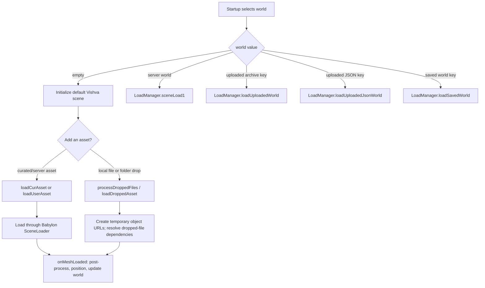
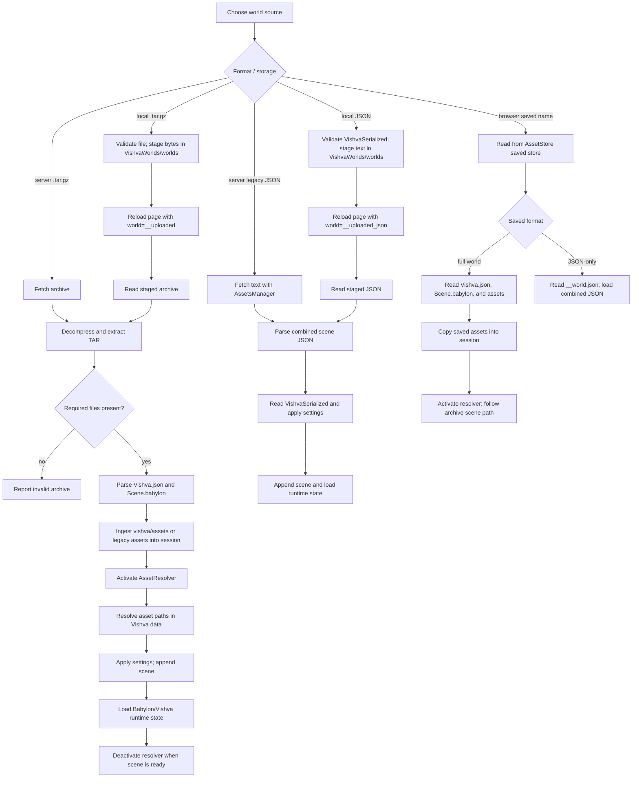
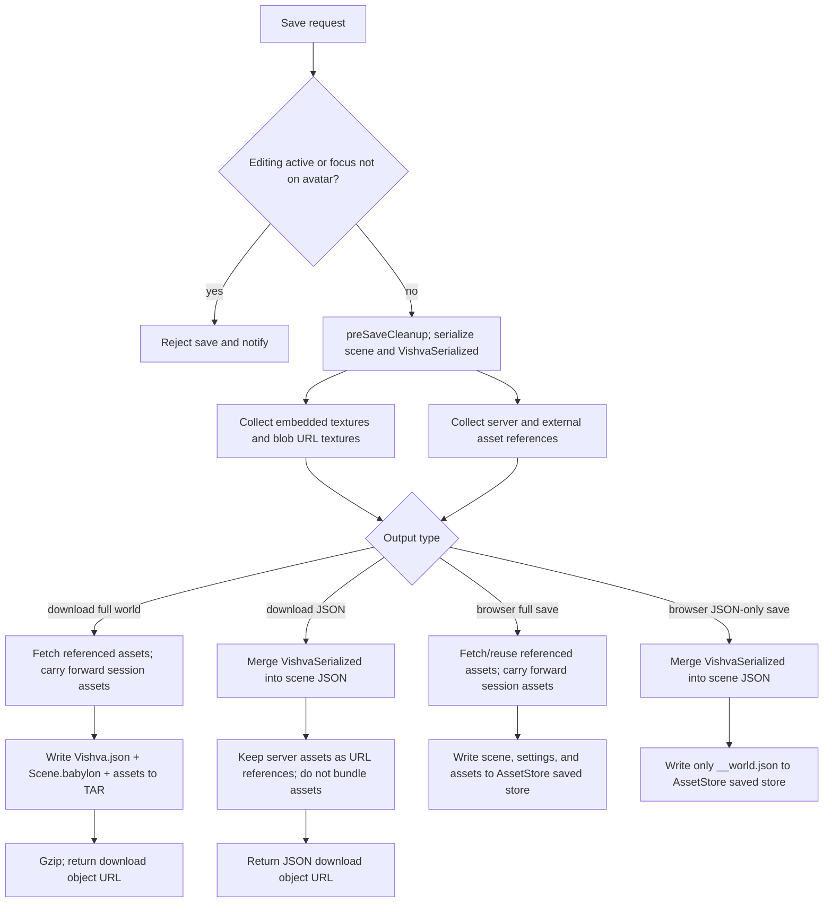

# World loading and saving flow

This document describes how [`LoadManager`](../src/managers/LoadManager.ts) and
[`SaveManager`](../src/managers/SaveManager.ts) work together for new worlds,
server worlds, local files, and browser-saved worlds. Startup routing is in
[`Vishva.ts`](../src/Vishva.ts); the URL's `world` value selects the initial
load path.

## At a glance

| World source or action | Entry point | What happens to assets |
|---|---|---|
| New/empty world | `Vishva` sees `sceneFile === "empty"` | Initializes the default Vishva scene; assets can then be added individually from the server or local files. |
| Server world (`.tar.gz`) | `sceneLoad1` → `loadZipWorld` | Fetches and extracts the archive; archive assets go into the active `AssetStore` session and are resolved while Babylon loads the scene. |
| Server legacy JSON | `sceneLoad1` → `loadVishvaPart` | Fetches one JSON document containing scene data and `VishvaSerialized`; no archive asset ingestion is done. |
| Local world archive (`.tar.gz`) | `loadWorldFromFile` → page reload → `loadUploadedWorld` | Validates and stages the archive in `VishvaWorlds/worlds`; after reload, extracts it and loads its assets into the active session. |
| Local legacy JSON | `loadWorldFromJsonFile` → page reload → `loadUploadedJsonWorld` | Validates and stages the JSON in `VishvaWorlds/worlds`; after reload, loads the combined scene/settings document. Assets are not bundled by this path. |
| Browser-saved world | `loadSavedWorld` | Reads the named world from `VishvaAssetStore/saved`; full saves copy assets into the session and activate an asset resolver. |

`VishvaWorlds/worlds` is temporary staging for a file upload across the page
reload. `VishvaAssetStore` has separate `session` (active world) and `saved`
(persistent named worlds) stores.

## Load flow

### Startup and adding assets to a new world

An empty world is not itself a model-loading operation. The user can add assets
after scene initialization: curated assets and server user assets are loaded
from `vHome + "assets/..."`; dropped models are imported from temporary object
URLs. For a dropped folder, the loader temporarily maps companion files (such as
textures) so Babylon can resolve dependencies. Loaded meshes are post-processed
and positioned by `onMeshLoaded`.

### Loading a complete world

The archive format requires both `Vishva.json` and `Scene.babylon`. Archive
assets may use the structured `vishva/assets/` prefix or the legacy `assets/`
prefix; legacy paths are remapped before they are put in the active session.
The resolver serves these stored files while the scene is being loaded, then
is deactivated once Babylon reports the scene ready.

The legacy JSON route does not extract an archive or populate the session from
the file. JSON-only worlds therefore rely on asset URLs that remain available
(typically server assets) or data already embedded in the JSON.

### What the load paths share

For archive and combined-JSON inputs, the manager applies `VishvaSerialized`
settings and then uses Babylon's scene append operation before calling
`loadBabylonjsPart`. Settings include serialized Vishva state such as camera
and world settings, SNAs, and other world metadata. The archive path can also
resolve stored asset references during loading.

`loadWorldFromFile` and `loadWorldFromJsonFile` intentionally do not replace
the live scene in place: they validate and stage the input, then reload the
page so the world loads in a fresh WebGL context. Uploaded staging records and
the upload URL parameter are cleaned up after the post-reload load attempt.

## Save flow

Before saving, both download methods and browser-save methods reject saving
while an edit control is active or focus is away from the avatar. The
serialization captures the Babylon scene and Vishva-specific data, including
settings, object IDs, mesh metadata, SNAs, spawners, and animation-sharing
metadata where present. Shared animation data is removed from the scene
serialization when its sharing metadata is available.

### Save formats and asset behavior

- **Full download — `saveWorld()`**: creates a gzip-compressed TAR archive. It
  contains `Vishva.json`, `Scene.babylon`, and collected binary assets. Server
  assets are fetched and their references are rewritten for the archive;
  embedded and blob textures are also extracted. Assets still referenced by
  the scene can be carried forward from the active AssetStore session.
- **JSON download — `saveWorldAsJson()`**: creates one legacy JSON document
  with `VishvaSerialized` merged into the scene object. It bundles no separate
  assets; server-available textures are kept as references rather than base64.
- **Browser full save — `saveWorldToIndexedDB()`**: writes the separate world
  JSON files plus asset data to the named world in `VishvaAssetStore/saved`.
  If AssetStore cannot be opened, it falls back to saving the full TAR blob in
  `VishvaWorlds/worlds`. That fallback is distinct from the normal saved-world
  read path: `loadSavedWorld()` reads `VishvaAssetStore/saved`, not this TAR
  entry.
- **Browser JSON-only save — `saveWorldToIndexedDBAsJson()`**: writes only
  `__world.json` to the named saved world. Its referenced server assets must
  remain accessible when the world is reopened.

The Save dialog offers both browser-save variants. The regular world download
uses the full archive; the JSON download is a legacy, asset-reference-based
format.

## Source map

- Startup route selection: [`Vishva.ts`](../src/Vishva.ts)
- World/archive/file/browser loading and dropped asset imports:
  [`LoadManager.ts`](../src/managers/LoadManager.ts)
- Download and browser-storage serialization:
  [`SaveManager.ts`](../src/managers/SaveManager.ts)
- Active and saved asset stores: [`AssetStore.ts`](../src/managers/AssetStore.ts)
- Save dialog choices: [`SavePromptUI.ts`](../src/gui/SavePromptUI.ts)
